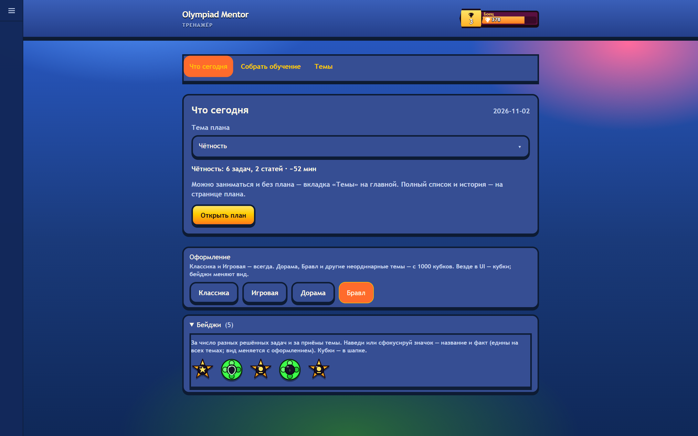
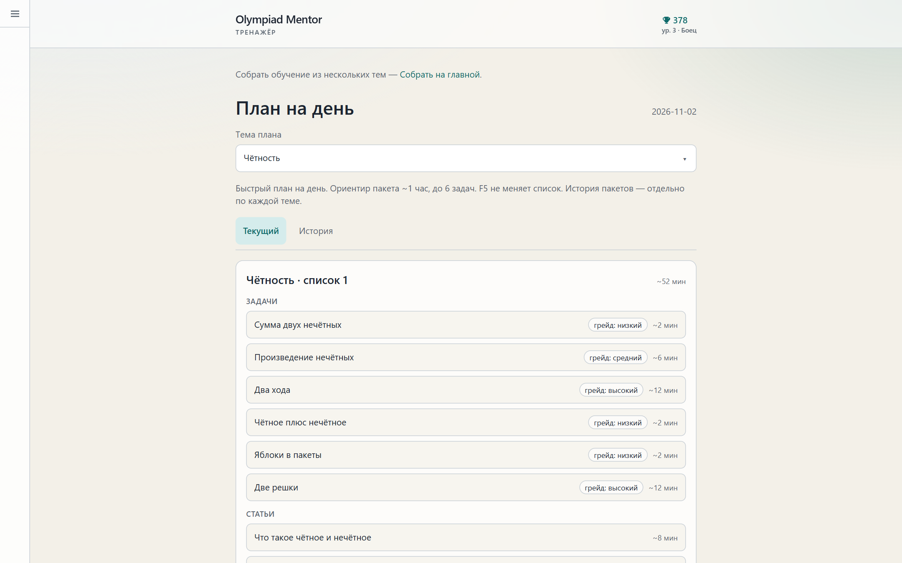
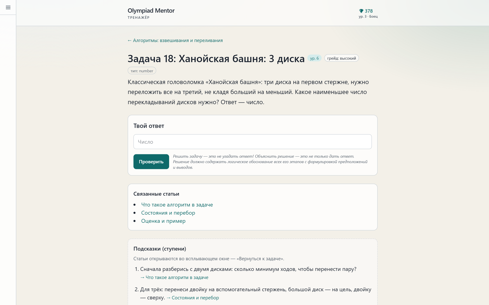
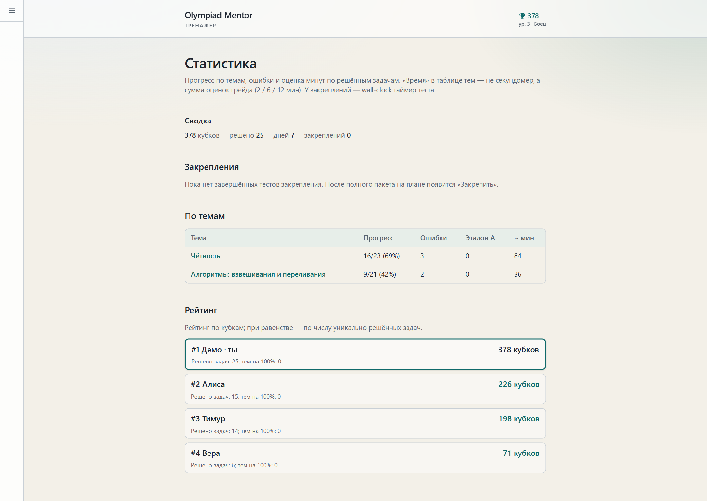
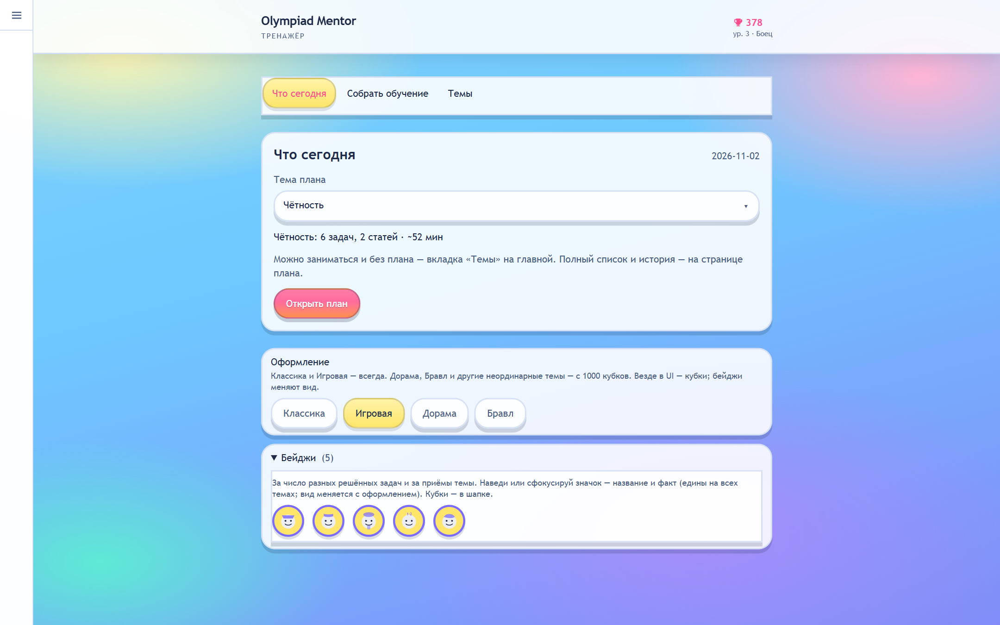
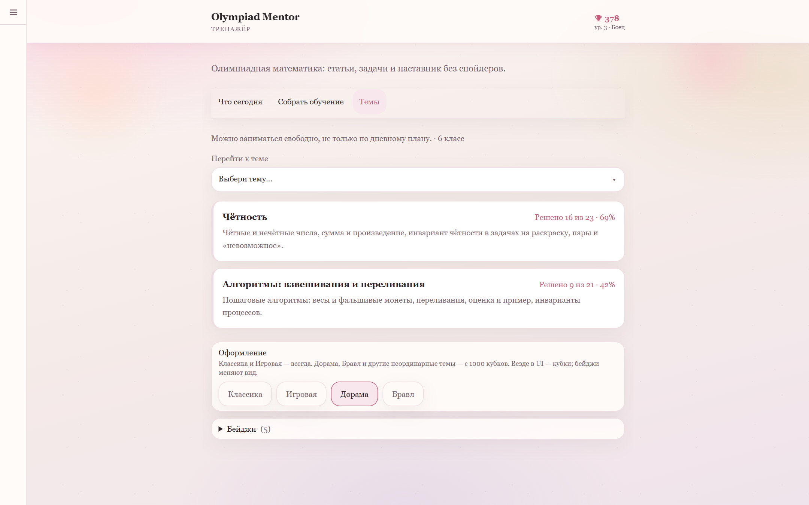
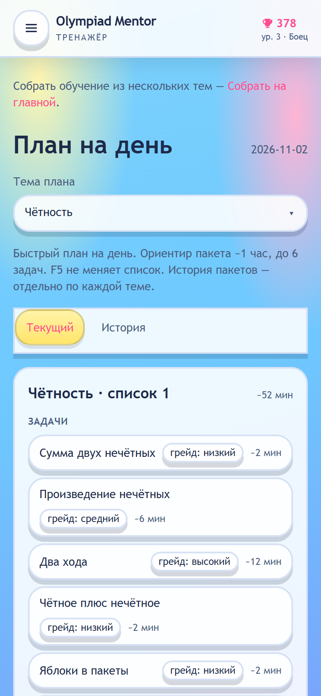
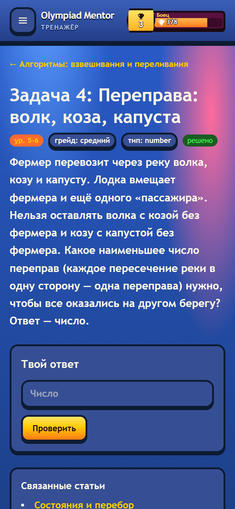
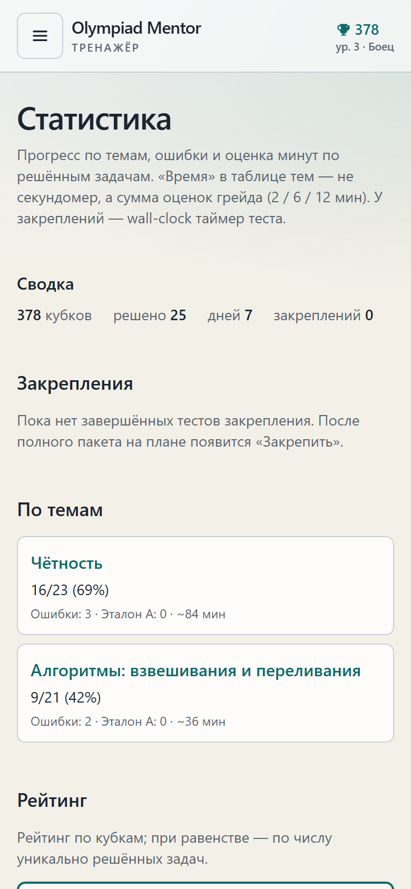

# Olympiad Mentor

*AI-powered math olympiad trainer for grades 5–6 with a non-spoiling AI tutor. Demo version: the interface and documentation are in Russian.*

Тренажёр олимпиадной математики для 5–6 классов с ИИ-наставником, который ведёт к решению и не выдаёт ответ сразу.

Это витрина: код продукта и демо-набор из 44 задач, собственных и классических. Полный банк и инструменты аудита ведутся в приватном репозитории; на ноябрь 2026 там 707 задач с 3 вариантами у каждой, 800+ коммитов и 240+ PR.

<p align="center">
  
</p>

## Что умеет

- **План дня:** подбирает пакет до 6 задач примерно на час, с учётом сложности и уже решённого.
- **ИИ-наставник:** наводит вопросами и ссылается на внутренние статьи; ответ модели фильтруется от утечки эталона. Без ключа или при сбое LLM работает на подсказках из базы.
- **Варианты задач:** у каждой задачи три варианта с другими данными, повторная попытка не сводится к запоминанию ответа.
- **Закрепление:** короткий тест по решённым задачам, на других вариантах.
- **Прогресс:** кубки, уровни, бейджи, статистика по темам, рейтинг, несколько тем оформления.

## Как это выглядит

Снимки реального приложения; прогресс и участники рейтинга — демо-данные.

**План дня и задача**

<p>
  
  
</p>

**Прогресс, рейтинг и статистика**

<p align="center">
  
</p>

**Темы оформления и бейджи:** у бейджей свой вид в каждой теме

<p>
  
  
</p>

**На телефоне**

<p align="center">
  
  
  
</p>

## Что здесь интересно инженеру

- **Проверка контента.** Эталонные ответы банка проходят решатели на коде и две независимые проверки другими LLM, с разделением ролей и сверкой с официальными решениями. Как это устроено: [`docs/CONTENT-QUALITY.md`](docs/CONTENT-QUALITY.md), роли и промпты: [`docs/ai-workflow/`](docs/ai-workflow/README.md).
- **Требования с трассировкой:** сущности, инварианты, ID требований и матрица трассировки в [`docs/SRS.md`](docs/SRS.md).
- **Процесс работы с LLM:** критерии приёмки до кода, код и тесты отдельными шагами, проверка другой моделью: [`docs/ENGINEERING-PROCESS.md`](docs/ENGINEERING-PROCESS.md).
- **Тесты:** unit-тесты на Vitest без обращений к живым LLM.

## Стек

Next.js 16, React 19, TypeScript, Tailwind CSS v4, Prisma + SQLite, Auth.js, Zod, Vitest. LLM: Google Gemini с запасным DeepSeek, оба подключаются по желанию. Подробнее: [`docs/ARCHITECTURE.md`](docs/ARCHITECTURE.md).

## Запуск

```bash
cp .env.example .env
npm install
npm run db:reset
npm run dev
```

Откройте http://localhost:3000/login и войдите как `demo` / `demo-local-only`. Эти данные только для локального запуска. Чтобы наставник отвечал через LLM, задайте в `.env` ключ `GEMINI_API_KEY`.

Проверки: `npm test`, `npm run typecheck`, `npm run build`.

## Документация

| Документ | Назначение |
|----------|------------|
| [`docs/CONTENT-QUALITY.md`](docs/CONTENT-QUALITY.md) | Как проверяются задачи, правила качества, источники |
| [`docs/ai-workflow/`](docs/ai-workflow/README.md) | Многомодельный аудит контента: роли, промпты, глоссарий |
| [`docs/SRS.md`](docs/SRS.md) | Системные требования |
| [`docs/ARCHITECTURE.md`](docs/ARCHITECTURE.md) | Архитектура и стек |
| [`docs/ENGINEERING-PROCESS.md`](docs/ENGINEERING-PROCESS.md) | Процесс разработки с LLM |
| [`docs/USER-GUIDE.md`](docs/USER-GUIDE.md) | Руководство пользователя и smoke |
| [`docs/ROADMAP.md`](docs/ROADMAP.md) | Итерации и планы |
| [`docs/HISTORY.md`](docs/HISTORY.md) | Вехи проекта |

## Лицензия

Код распространяется по лицензии [MIT](LICENSE). Там же оговорка о задачах.
